<div dir="rtl" align="center">

# ⚡ دیجی‌شاپ

**فروشگاه آنلاین تجهیزات شبکه — ساخته‌شده با Laravel**

[](https://laravel.com)
[](https://php.net)
[](https://github.com/MSS1625/shop-php/actions/workflows/ci.yml)
[](../../releases)
[](LICENSE)
[](CONTRIBUTING.md)

فروشگاه اینترنتی کامل با پنل مدیریت، سبد خرید، پرداخت آنلاین زرین‌پال و مدیریت سفارش‌ها — راست‌چین، فارسی و با طراحی دارک مدرن.

**🌐 پیش‌نمایش آنلاین رابط کاربری:** <https://mss1625.github.io/shop-php/>

</div>

---

[English](README.md) | **فارسی**

---

<div dir="rtl" align="center">

| خانه | محصولات |
|:---:|:---:|
| 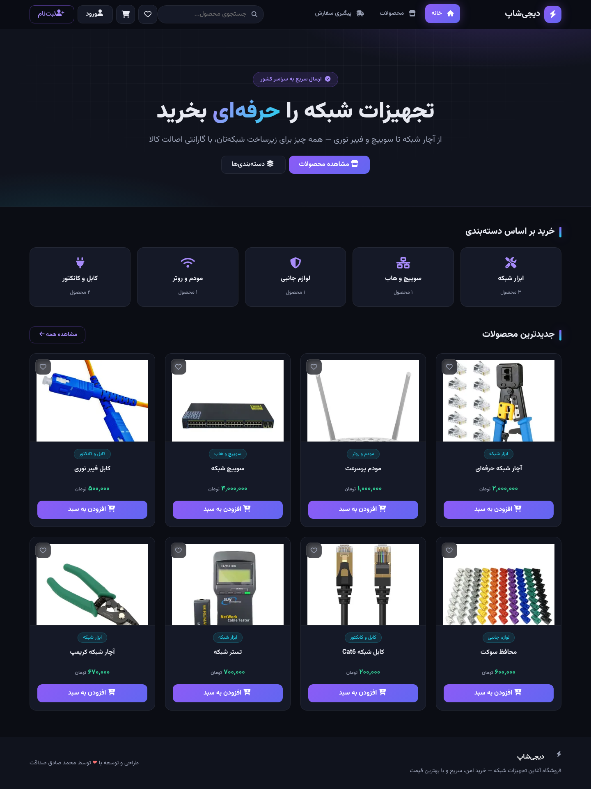 | 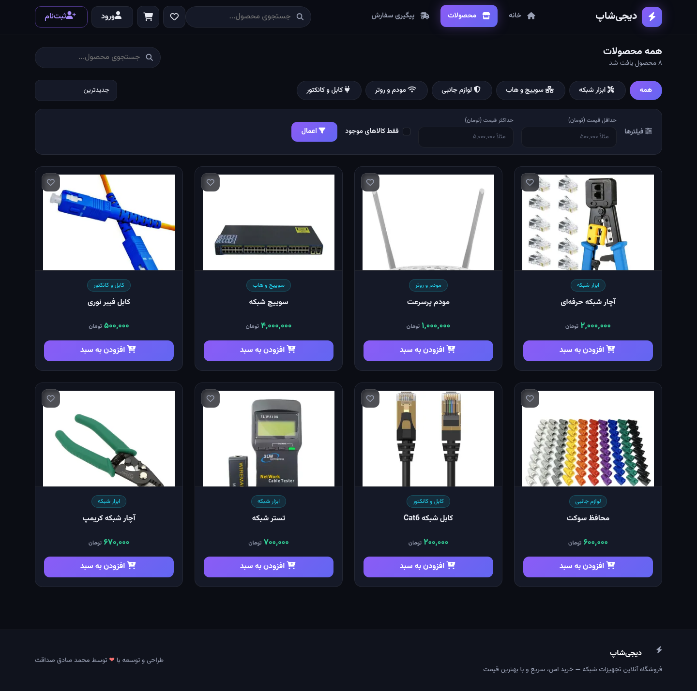 |

| تسویه‌حساب و پرداخت | درگاه آزمایشی |
|:---:|:---:|
| 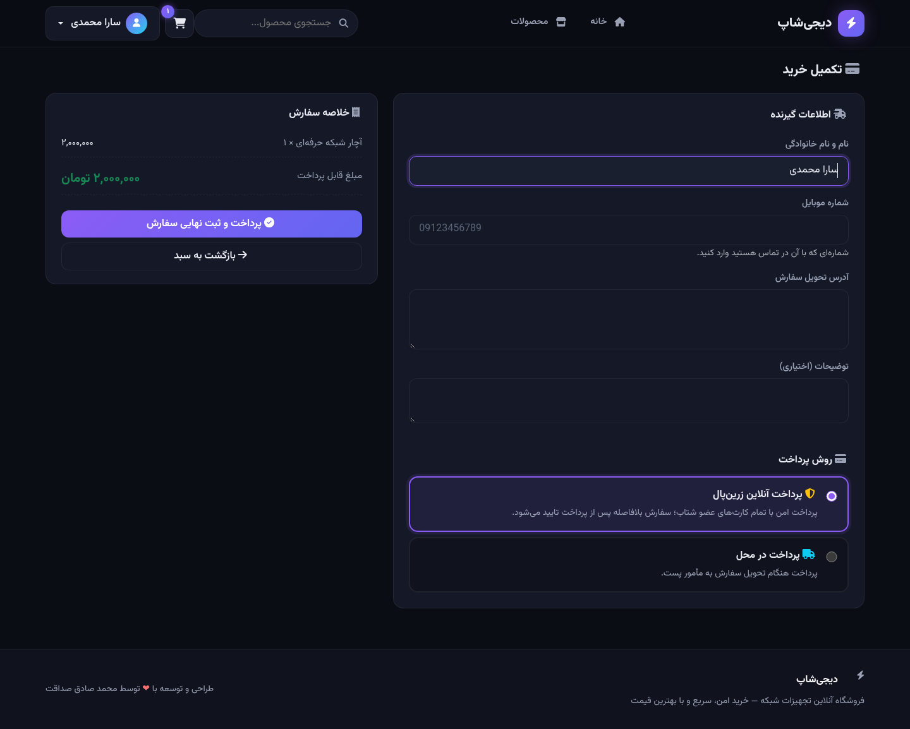 |  |

| سفارش‌های من | رهگیری سفارش |
|:---:|:---:|
| 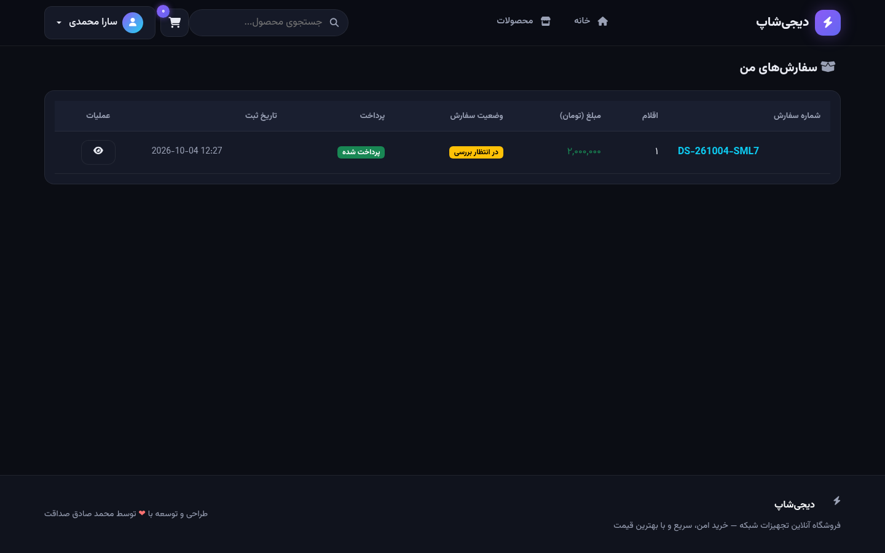 | 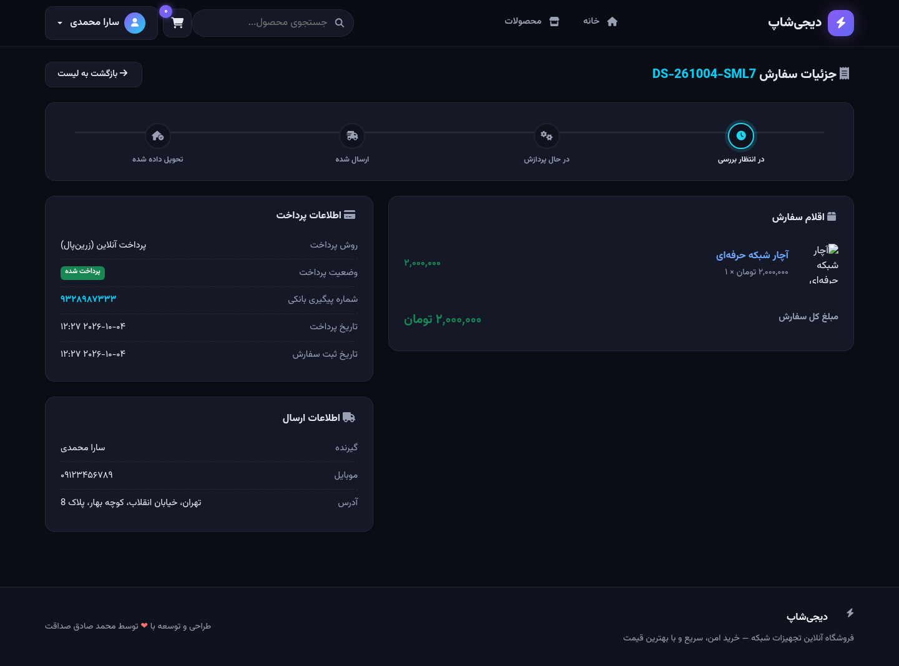 |

| داشبورد مدیریت | سفارش‌ها (ادمین) |
|:---:|:---:|
| 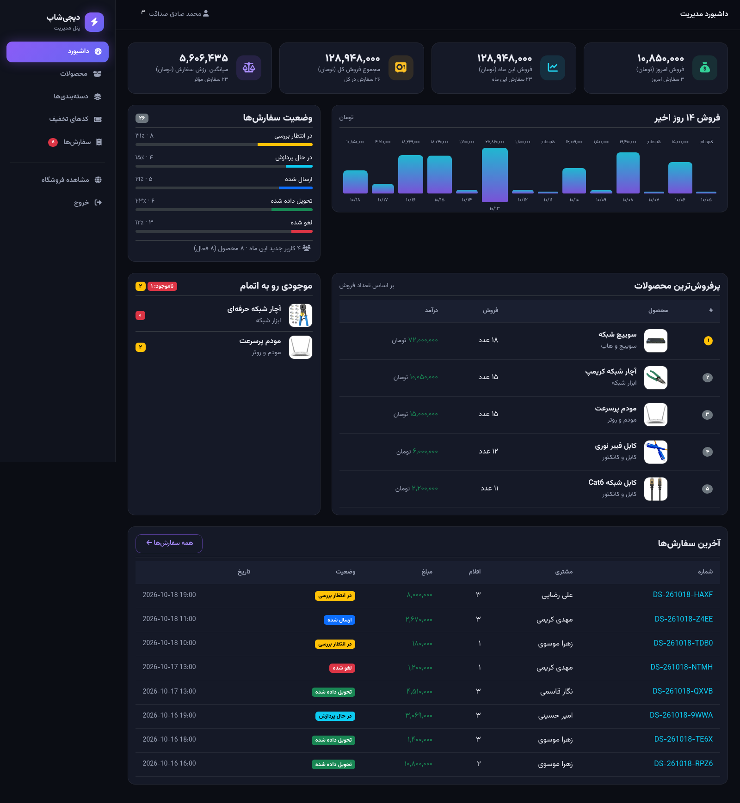 | 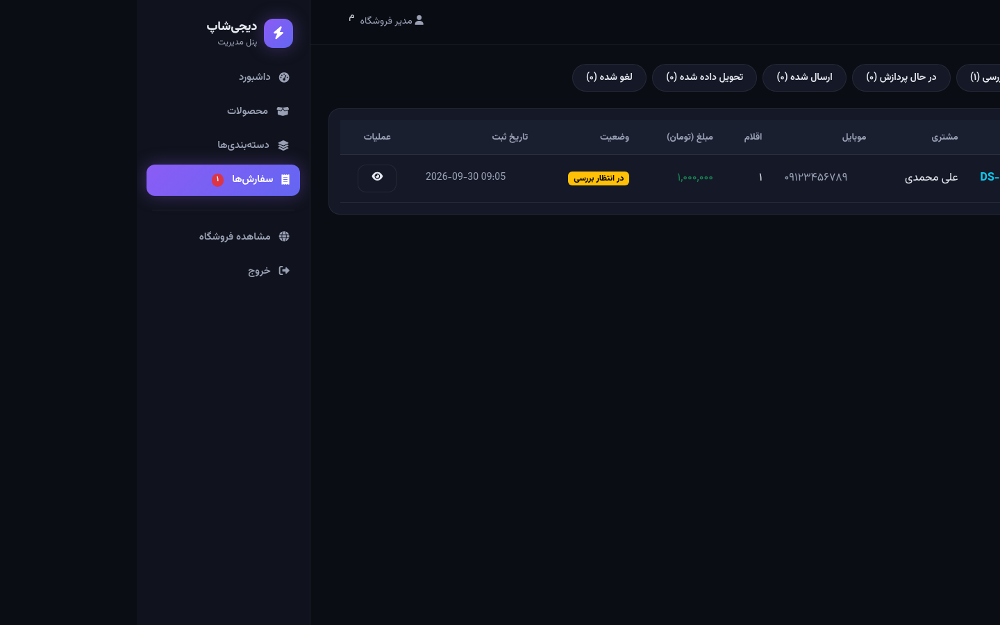 |

| صفحه محصول (گالری) | فرم گالری در ادمین |
|:---:|:---:|
| 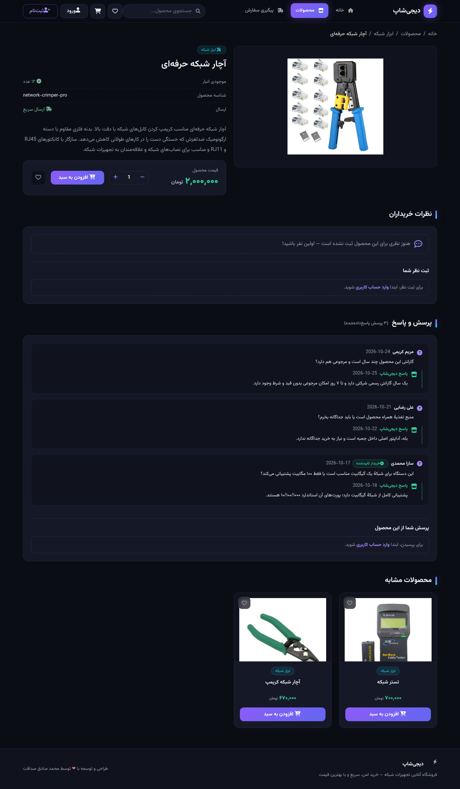 | 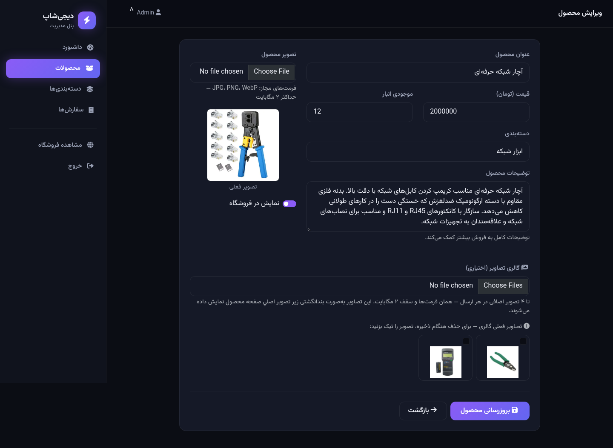 |

| سبد خرید با کد تخفیف | مدیریت کدهای تخفیف |
|:---:|:---:|
| 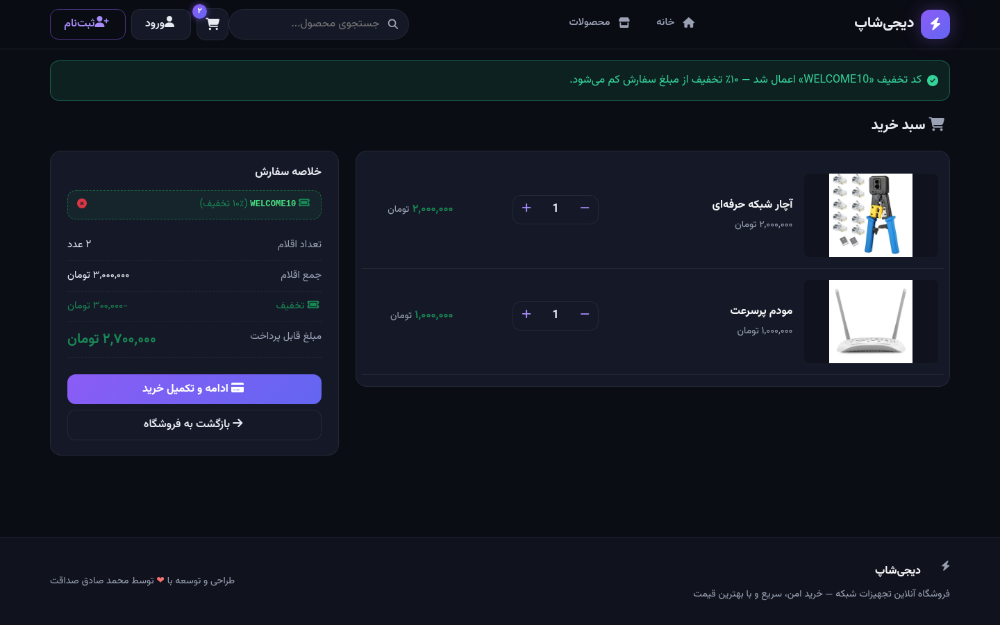 | 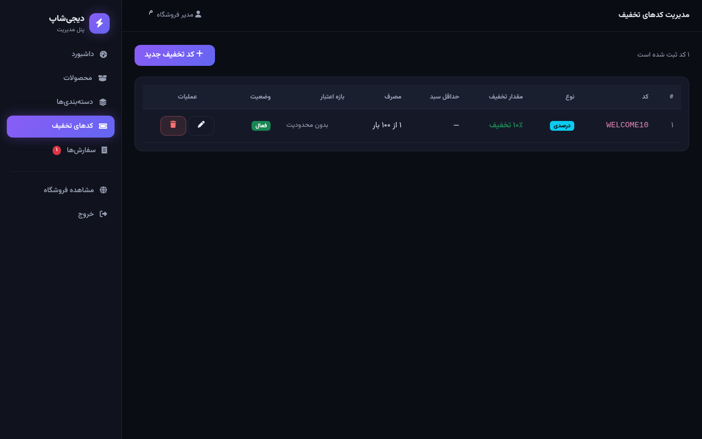 |

| REST API (Sanctum) |
|:---:|
| 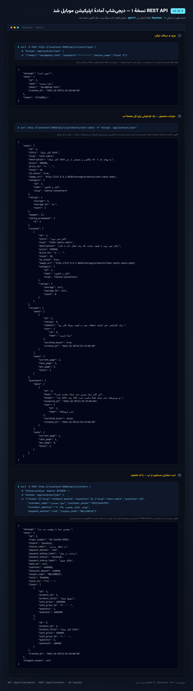 |

</div>

## 🌐 پیش‌نمایش آنلاین (GitHub Pages)

یک **صفحه دموی ایستا** از رابط کاربری فروشگاه روی GitHub Pages میزبانی شده است:

> **<https://mss1625.github.io/shop-php/>**

این صفحه صفحهٔ اصلی فروشگاه (هیرو، دسته‌بندی‌ها و کارت‌های محصول) را با محصولات نمونه واقعی بازسازی می‌کند. توجه کنید که GitHub Pages فقط فایل‌های ایستا سرو می‌کند — **نسخه کامل** برنامه (سبد خرید، تسویه‌حساب، پرداخت و پنل مدیریت) با PHP و از راه‌اندازی سریع ۴ فرمانی پایین اجرا می‌شود. لینک پیش‌نمایش در بخش **About** مخزن هم ثبت شده و مستقیم از صفحه پروژه قابل مشاهده است.

## ✨ امکانات

- 📡 **REST API نسخهٔ ۱ (Sanctum، آمادهٔ موبایل)** — کل فروشگاه پشت ۱۸ نقطهٔ اتصال توکنی زیر `/api/v1`: ثبت‌نام/ورود/خروج (توکن به تفکیک دستگاه)، کاتالوگ با همان فیلترهای ویترین (بازهٔ قیمت با ارقام فارسی)، جزئیات محصول در یک فراخوانی (گالری + تفکیک امتیاز + نظرات با نشان خریدار + پرسش‌های پاسخ‌داده + مشابه‌ها)، **ثبت سفارش مستقیم با کد تخفیف** از همان سرویس `PlaceOrder` فرم خرید وب، تاریخچه/لغو سفارش، علاقه‌مندی idempotent و ثبت نظر/پرسش — محدودیت ۶۰ درخواست در دقیقه، پاسخ‌های استاندارد 422/401/409
- 💳 **پرداخت آنلاین زرین‌پال** — اتصال کامل به API نسخه ۴ زرین‌پال با تایید سمت سرور، امکان تلاش مجدد پس از خطا + گزینه «پرداخت در محل»؛ همراه با **درگاه آزمایشی محلی** برای تست کل جریان بدون نیاز به پذیرنده
- 👤 **حساب کاربری مشتری** — ثبت‌نام/ورود، داشبورد با آمار خرید، تاریخچه کامل سفارش‌ها و تایم‌لاین پیگیری وضعیت؛ خرید مهمان هم همچنان ممکن است
- 🚚 **پیگیری سفارش مهمان** — صفحهٔ عمومی `/track` که مشتری فقط با شماره سفارش + موبایلی که موقع خرید وارد کرده سفارشش را دنبال می‌کند؛ همان تایم‌لاین ۴ مرحله‌ای، وضعیت پرداخت و تلاش مجدد پرداخت — با محدودیت نرخ، پیام خطای یکسان (ضد enumeration) و صفحهٔ حداقلِ داده
- 🛒 **سبد خرید کامل** — افزودن/حذف/تغییر تعداد بدون رفرش صفحه (Ajax)
- ❤️ **علاقه‌مندی‌ها** — با یک کلیک روی قلب، محصول برای بعد ذخیره می‌شود (گوشهٔ کارت + صفحهٔ جزئیات) و کلیک دوم آن را حذف می‌کند — چرخش Ajax با شمارندهٔ زندهٔ ناوبار، جایگزین PRG بدون جاوااسکریپت، صفحهٔ اختصاصی `/wishlist` (جدیدترین اول، ۱۲تا در صفحه) و یک ردیف برای هر کاربر/محصول با قید یکتای دیتابیس
- ❓ **پرسش و پاسخ محصولات** — مشتری‌ها مستقیم در صفحهٔ محصول سؤال می‌پرسند؛ پرسش‌ها تا وقتی مدیر از پنل `/admin/questions` (جعبهٔ پاسخ داخل خود ردیف جدول) جواب ندهد خصوصی می‌مانند و بعد با برند «پاسخ دیجی‌شاپ» و همان نشان خریدار تأییدشدهٔ نظرات عمومی می‌شوند — به‌علاوهٔ ایمیل «پاسخ پرسش شما» به پرسنده، فقط یک‌بار (ویرایش بی‌صدا) و بدون شکستن با خطای SMTP
- 📦 **مدیریت سفارش‌ها** — ثبت سفارش، گردش کار وضعیت (در انتظار ← پردازش ← ارسال ← تحویل/لغو)، کاهش و بازگشت خودکار موجودی انبار، لغو سفارش توسط مشتری با بازگشت موجودی
- 🔍 **جستجو، فیلتر و مرتب‌سازی** — جستجوی زنده محصولات، فیلتر دسته‌بندی، **فیلتر بازهٔ قیمت و فقط موجود** (سازگار با ارقام فارسی، بازهٔ برعکس بی‌صدا جابه‌جا می‌شود)، مرتب‌سازی **پرفروش‌ترین** (بدون احتساب سفارش‌های لغوشده)، مرتب‌سازی قیمتی و جدیدترین، صفحه‌بندی — و در صفحهٔ جزئیات، محصولات مشابه همیشه موارد موجود را اول نشان می‌دهند
- ⭐ **نظرات و امتیازدهی** — امتیاز ۱ تا ۵ ستاره و نظر روی صفحهٔ محصول با میانگین درشت، نمودار تفکیک ۵ به ۱ و نشان **«خریدار تأییدشده»** برای نویسنده‌هایی که واقعاً محصول را خریده‌اند؛ هر نظر پیش از نمایش به تأیید مدیر می‌رسد، کارت‌ها همه‌جا امتیاز را نشان می‌دهند و هر کاربر برای هر محصول یک نظر دارد
- 🗂 **دسته‌بندی‌ها** — دسته‌بندی پویا با آیکون و تعداد محصولات
- 📊 **داشبورد گزارش‌های مدیریت** — شاخص‌های فروش (امروز / این ماه / کل / میانگین ارزش سفارش)، نمودار ۱۴ روزه با یک کوئری گروهی، پرفروش‌ترین محصولات، تفکیک وضعیت سفارش‌ها با نوار پیشرفت و هشدار موجودی کم/ناموجود — همهٔ کوئری‌ها در سرویس قابل‌آزمون `DashboardStats`
- 🖼 **آپلود امن تصویر** — فقط تصاویر معتبر (JPG/PNG/WebP حداکثر ۲ مگابایت) با نام تصادفی
- 🖼️ **گالری تصاویر محصول** — چند تصویر برای هر محصول؛ نوار بندانگشتی در صفحه جزئیات، تصویر اصلی را عوض می‌کند؛ حذف ضد IDOR در ادمین
- 🎟 **کدهای تخفیف** — کدهای درصدی/مبلغ ثابت با سقف مصرف، حداقل مبلغ سبد و بازه اعتبار؛ مصرف ضدرقابت داخل تراکنش سفارش + صفحه مدیریت کامل در پنل ادمین
- 📧 **اطلاع‌رسانی ایمیلی سفارش** — ایمیل‌های ثبت سفارش، تأیید پرداخت و تغییر وضعیت با قالب‌های راست‌چین فارسی؛ قراردادمحور (`OrderNotifier`)؛ خطاها ایزوله‌اند — خرابی SMTP هرگز ثبت سفارش را نمی‌شکند
- 📱 **اطلاع‌رسانی پیامکی (کاوه‌نگار)** — همان سه رویداد سفارش به‌صورت پیام‌های کوتاه فارسی؛ قرارداد دوم `SmsGateway` (ارسال واقعی با `KavenegarSmsGateway` و درایور لاگ برای توسعه/تست) به‌همراه `CompositeNotifier` تا ایمیل و پیامک کنار هم کار کنند — اتصال فقط با یک binding و بدون حتی یک خط تغییر در کنترلرها
- 🌐 **کاملاً فارسی** — راست‌چین، فونت وزیرمتن، اعداد فارسی (۰۱۲۳۴۵۶۷۸۹)، واحد تومان
- 🌙 **رابط دارک مدرن** — تم نئونی بنفش بر پایه Bootstrap 5 RTL
- 🔐 **امنیت سخت‌گیرانه** — CSRF، محدودیت ورود، خروجی امن Blade، هدرهای امنیتی و پرداخت اتمیک

## 📡 REST API نسخهٔ ۱ (آمادهٔ موبایل)

همهٔ نقاط اتصال زیر `/api/v1` هستند و JSON برمی‌گردانند. احراز هویت با توکن Sanctum: هدر `Authorization: Bearer <token>` بفرستید (توکن را از login یا register بگیرید). محدودیت نرخ: ۶۰ درخواست در دقیقه برای هر توکن.

| متد | مسیر | توکن | توضیح |
|---|---|---|---|
| POST | `/auth/register` | — | ساخت حساب + توکن (`device_name` اختیاری) |
| POST | `/auth/login` | — | صدور توکن (پیام خطای کلی، ۱۰ در دقیقه) |
| GET | `/auth/me` | ✅ | پروفایل کاربر جاری |
| POST | `/auth/logout` | ✅ | باطل‌کردن **فقط توکن همین دستگاه** |
| GET | `/categories` | — | دسته‌ها با شمارندهٔ محصولات فعال |
| GET | `/products` | — | همان فیلترهای فروشگاه: `q`, `category`, `min`, `max` (ارقام فارسی اوکی), `in_stock`, `sort` (شامل `popular`) |
| GET | `/products/{slug}` | — | صفحهٔ محصول در یک فراخوانی: گالری، خلاصهٔ امتیاز + تفکیک ۵→۱، نظرات + پرسش‌ها (صفحهٔ اول، با نشان خریدار), ۴ مشابه |
| GET | `/products/{slug}/reviews` | — | نظرات تأییدشده، صفحه‌بندی ۱۰تایی |
| POST | `/products/{slug}/reviews` | ✅ | ثبت نظر (شروع در انتظار؛ یک نظر برای هر کاربر/محصول) |
| GET | `/products/{slug}/questions` | — | پرسش‌های پاسخ‌داده، صفحه‌بندی ۱۰تایی |
| POST | `/products/{slug}/questions` | ✅ | پرسیدن (شروع در انتظار) |
| GET | `/wishlist` | ✅ | علاقه‌مندی‌ها (فقط فعال، جدیدترین اول، ۱۲تا) |
| POST | `/wishlist/{slug}` | ✅ | افزودن (idempotent) |
| DELETE | `/wishlist/{slug}` | ✅ | حذف (idempotent) |
| GET | `/orders` | ✅ | سفارش‌های من (۱۰تایی، جدیدترین اول) |
| POST | `/orders` | ✅ | **ثبت مستقیم سفارش** — `items[{slug,quantity}]`، اطلاعات مشتری، `payment_method`، `coupon_code`؛ سفارش زرین‌پال `payment_url` برمی‌گرداند |
| GET | `/orders/{order_number}` | ✅ | جزئیات سفارش (فقط سفارش خودت، وگرنه 404) |
| POST | `/orders/{order_number}/cancel` | ✅ | لغو سفارش در-انتظار و پرداخت‌نشده (بازگشت اتمیک موجودی) |

```bash
# ورود و گرفتن توکن
curl -s -X POST http://localhost:8000/api/v1/auth/login \
  -H "Accept: application/json" -H "Content-Type: application/json" \
  -d '{"email":"you@example.com","password":"secret","device_name":"Pixel 8"}'

# ثبت سفارش مستقیم از اپ، با کد تخفیف
curl -s -X POST http://localhost:8000/api/v1/orders \
  -H "Authorization: Bearer $TOKEN" -H "Accept: application/json" \
  -H "Content-Type: application/json" \
  -d '{"items":[{"slug":"network-switch","quantity":1}],
       "customer_name":"سارا محمدی","customer_phone":"09123456789",
       "customer_address":"تهران، خیابان ولیعصر، پلاک ۱۲",
       "payment_method":"cod","coupon_code":"WELCOME10"}'
```

پاسخ سفارش هم مقدار خام برای منطق اپ دارد (`status`, `total`) **هم** برچسب فارسی آمادهٔ نمایش (`status_label`, `total_fa`) — و برای سفارش آنلاین `payment_url` (بازش کنید در WebView).

## 🚀 راه‌اندازی سریع (SQLite — بدون تنظیمات)

```bash
# ۱) دریافت و نصب وابستگی‌ها
git clone https://github.com/MSS1625/shop-php.git
cd shop-php
composer install

# ۲) نصب یک‌مرحله‌ای (env + کلید + مهاجرت + داده اولیه + لینک تصاویر)
php artisan shop:install

# ۳) ساخت کاربر مدیر (تعاملی)
php artisan admin:create

# ۴) اجرا
php artisan serve
```

حالا **http://localhost:8000** را باز کنید — فروشگاه با ۸ محصول نمونه آماده است. 🎉

## 🛠 راه‌اندازی با XAMPP / MySQL

۱. در phpMyAdmin یک دیتابیس خالی با نام `shop_php` بسازید

۲. در فایل `.env` خط SQLite را کامنت و بخش MySQL را از کامنت خارج کنید:

```env
# DB_CONNECTION=sqlite
DB_CONNECTION=mysql
DB_HOST=127.0.0.1
DB_PORT=3306
DB_DATABASE=shop_php
DB_USERNAME=root
DB_PASSWORD=
```

۳. نصب و اجرا:

```bash
php artisan shop:install
php artisan admin:create
php artisan serve
```

> **پیش‌نیازها:** PHP نسخه 8.2 به بالا با اکستنشن‌های `pdo_sqlite` (یا `pdo_mysql`)، `mbstring`، `gd` و `fileinfo` — همه به‌صورت پیش‌فرض در XAMPP فعال هستند.

## 💳 درگاه پرداخت زرین‌پال

لایه پرداخت بر پایه قرارداد `PaymentGateway` پیاده‌سازی شده و سه حالت با فایل `.env` قابل انتخاب است:

| حالت | مقدار | توضیح |
|---|---|---|
| **آزمایشی محلی** (پیش‌فرض) | `mock` | شبیه‌ساز محلی پرداخت — بدون اینترنت و بدون پذیرنده؛ برای توسعه و دمو |
| **سندباکس** | `sandbox` | محیط آزمایشی زرین‌پال (`sandbox.zarinpal.com`) |
| **واقعی** | `production` | پرداخت واقعی (`payment.zarinpal.com`) |

برای فعال‌سازی پرداخت واقعی، **شناسه پذیرنده** (UUID ۳۶ کاراکتری) را از [پنل زرین‌پال](https://zarinpal.com) بگیرید و تنظیم کنید:

```env
ZARINPAL_MERCHANT_ID=xxxxxxxx-xxxx-xxxx-xxxx-xxxxxxxxxxxx
ZARINPAL_MODE=production
# مبلغ سفارش‌ها «تومان» است و API زرین‌پال «ریال» می‌گیرد؛ ضریب پیش‌فرض ۱۰ است
ZARINPAL_AMOUNT_MULTIPLIER=10
```

**جریان پرداخت:** تکمیل خرید ← ثبت اتمیک سفارش و رزرو موجودی ← هدایت به درگاه ← تایید **سمت سرور** پس از بازگشت (به کوئری‌استرینگ اعتماد نمی‌شود) ← سفارش «پرداخت‌شده» با شماره پیگیری بانکی. پرداخت ناموفق/لغوشده قابل تلاش مجدد است و «پرداخت در محل» هم به‌عنوان گزینه دوم موجود است.

## 🔐 امنیت

| تهدید | راهکار |
|---|---|
| SQL Injection | استفاده کامل از Eloquent ORM و کوئری‌های پارامتری |
| XSS | خروجی امن خودکار Blade — `{{ }}` |
| CSRF | توکن `@csrf` در همه فرم‌ها |
| حمله Brute Force | حداکثر ۵ تلاش ناموفق در دقیقه برای هر ایمیل+IP |
| آپلود فایل خطرناک | اعتبارسنجی تصویر + وایت‌لیست فرمت + محدودیت حجم + نام تصادفی |
| دستکاری پرداخت | نتیجه پرداخت فقط با فراخوانی سرور به سرور (verify) تایید می‌شود |
| دسترسی غیرمجاز به سفارش‌ها | هر سفارش فقط برای مالک آن (یا مدیر) قابل مشاهده است؛ صفحات پرداخت به سشن گره خورده‌اند |
| Session Fixation | بازسازی شناسه سشن هنگام ورود |
| Mass Assignment | لیست سفید `$fillable` در همه مدل‌ها |
| Clickjacking | هدرهای امنیتی استاندارد |

## 📁 ساختار پروژه

```
app/
├── Console/Commands/      # shop:install و admin:create
├── Contracts/             # PaymentGateway (قرارداد درگاه پرداخت)
├── Exceptions/            # StockUnavailable, PaymentGateway, PaymentVerificationFailed
├── Http/
│   ├── Controllers/
│   │   ├── Admin/         # Dashboard, Product, Category, Order
│   │   ├── Auth/          # AdminLogin, Login, Register
│   │   └── Shop/          # Home, Product, Cart, Checkout, Payment, Account
│   ├── Middleware/        # EnsureUserIsAdmin, SecurityHeaders
│   └── Requests/          # اعتبارسنجی فرم‌ها
├── Models/                # Product, Category, Order, OrderItem, User
├── Services/
│   ├── Cart.php           # سرویس سبد خرید مبتنی بر سشن
│   └── Payments/          # ZarinPalGateway, MockGateway
database/seeders/images/   # تصاویر نمونه محصولات
docs/                      # صفحه دموی ایستا برای GitHub Pages
public/assets/             # تم دارک + اسکریپت سبد خرید
resources/views/           # قالب‌های Blade (فروشگاه + ادمین + احراز هویت + حساب)
.github/workflows/ci.yml   # اجرای خودکار تست روی هر push
README.md / README.fa.md   # English | فارسی
```

## 🧪 تست‌ها و CI

```bash
php artisan test        # ۲۶۴ تست Feature
vendor/bin/pint --test  # بررسی سبک کد
```

روی هر `push` و هر `pull request`، تست‌ها به‌صورت خودکار روی GitHub Actions (PHP 8.2 / 8.3 / 8.4 + Pint) اجرا می‌شوند — بج بالای همین فایل.

## 🗺 نقشه راه

- [x] درگاه پرداخت آنلاین (زرین‌پال)
- [x] حساب کاربری و تاریخچه سفارش‌ها
- [x] GitHub Actions CI
- [x] وب‌سایت پروژه (دموی GitHub Pages)
- [x] گالری تصاویر محصول (چند تصویر)
- [x] کد تخفیف (کدهای تخفیف)
- [x] اطلاع‌رسانی ایمیلی
- [x] اطلاع‌رسانی پیامک
- [x] داشبورد گزارش‌ها (شاخص‌ها، پرفروش‌ها، نمودار ۱۴ روزه)
- [x] پیگیری سفارش مهمان (صفحه عمومی /track)
- [x] کشف هوشمند محصولات (بازهٔ قیمت، فیلتر موجودی، پرفروش‌ترین، ارتقای محصولات مشابه)
- [x] نظرات و امتیازدهی محصولات (نشان خریدار تأییدشده، جریان بررسی، خلاصهٔ امتیاز و نمودار تفکیک)
- [x] علاقه‌مندی‌های مشتری (قلب toggle، صفحهٔ /wishlist، شمارندهٔ زندهٔ ناوبار)
- [x] پرسش و پاسخ محصولات (پرسش در صفحهٔ محصول، جریان پاسخ مدیر، ایمیل پاسخ)
- [x] REST API نسخهٔ ۱ با Sanctum (آمادهٔ موبایل: توکن، کاتالوگ، سفارش مستقیم، علاقه‌مندی، نظرات، پرسش‌ها)

## 🤝 مشارکت

پیشنهادها و Pull Request ها خوش‌آمدند! قبل از ارسال `composer test` و `vendor/bin/pint` را اجرا کنید. راهنمای کامل در [CONTRIBUTING.md](CONTRIBUTING.md).

## 👤 نویسنده

**محمد صادق صداقت** — با ❤️

## 📄 مجوز

این پروژه تحت مجوز [MIT](LICENSE) منتشر شده است.
