<div align="center">

# ⚡ دیجی‌شاپ

**Online Shop for Network Equipment — built with Laravel**

[](https://laravel.com)
[](https://php.net)
[](https://github.com/MSS1625/shop-php/actions/workflows/ci.yml)
[](https://github.com/MSS1625/shop-php/actions/workflows/ci.yml)
[](../../releases)
[](LICENSE)
[](CONTRIBUTING.md)

A complete online shop with admin panel, shopping cart, ZarinPal online payment and order management — RTL, Persian-first, dark modern UI.

**🌐 Live UI preview:** <https://mss1625.github.io/shop-php/>

</div>

---

**English** | [فارسی](README.fa.md)

---

<div align="center">

| Home | Products |
|:---:|:---:|
| 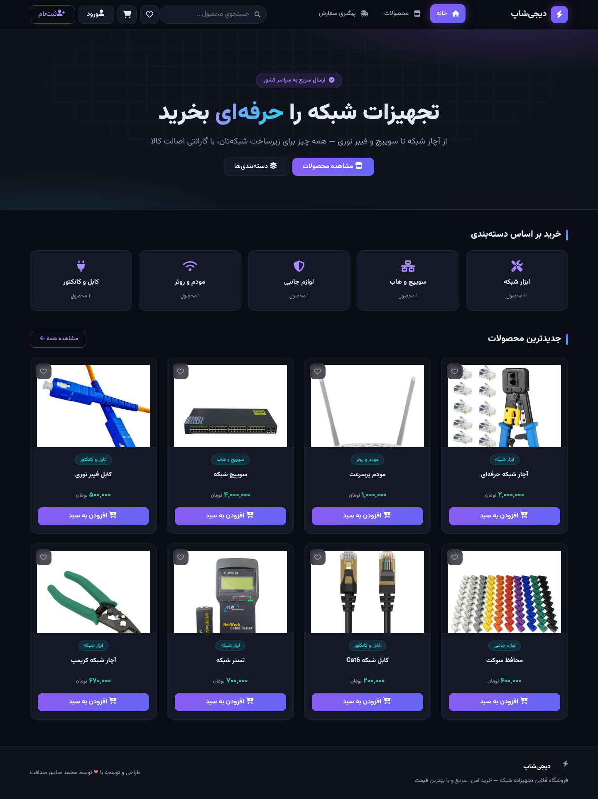 | 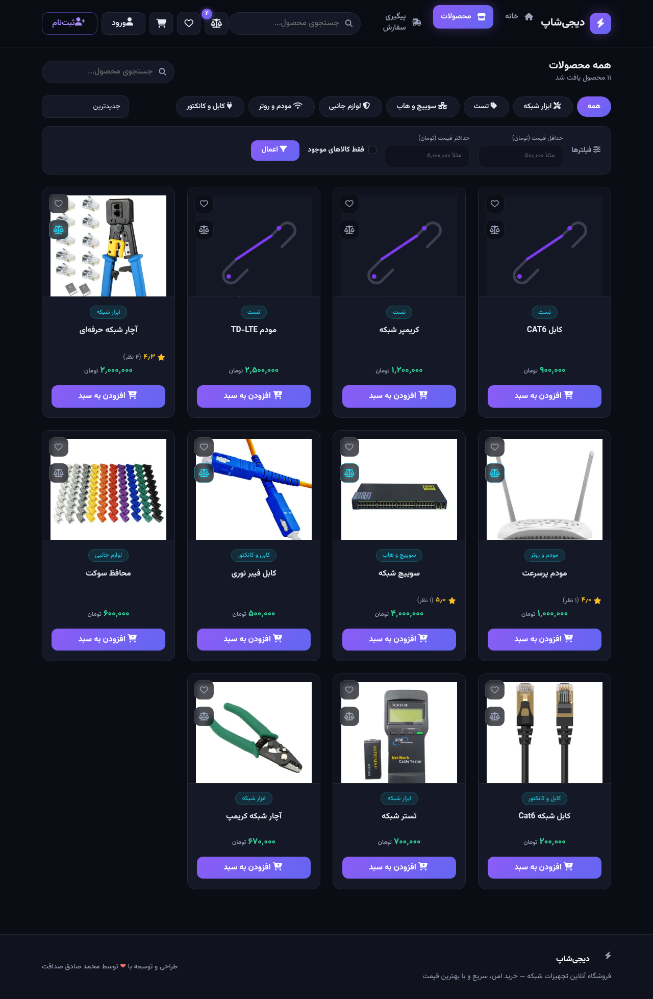 |

| Checkout & Payment | Mock Gateway |
|:---:|:---:|
| 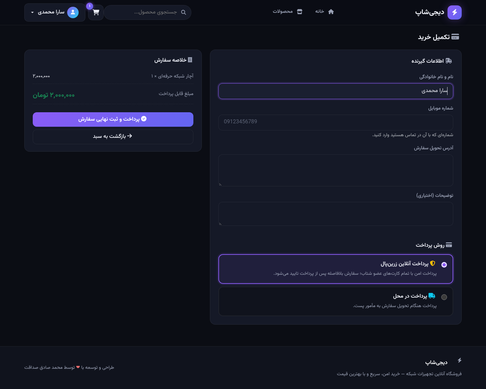 | 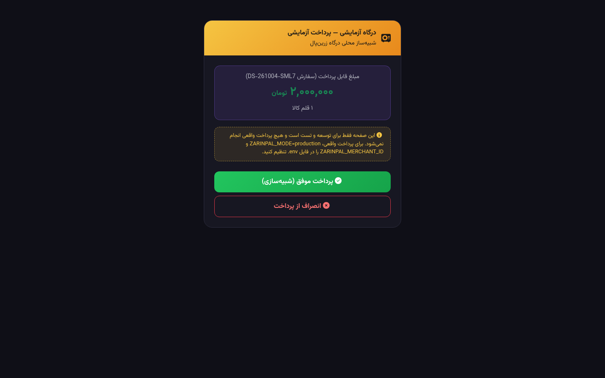 |

| Account Orders | Order Tracking |
|:---:|:---:|
| 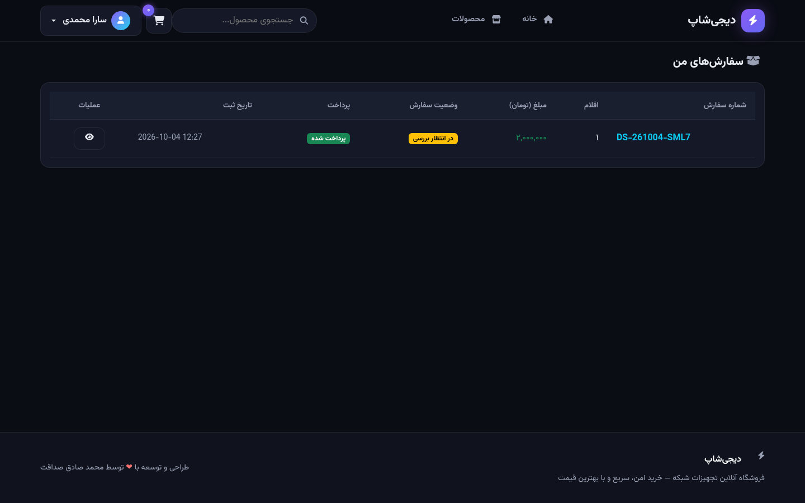 | 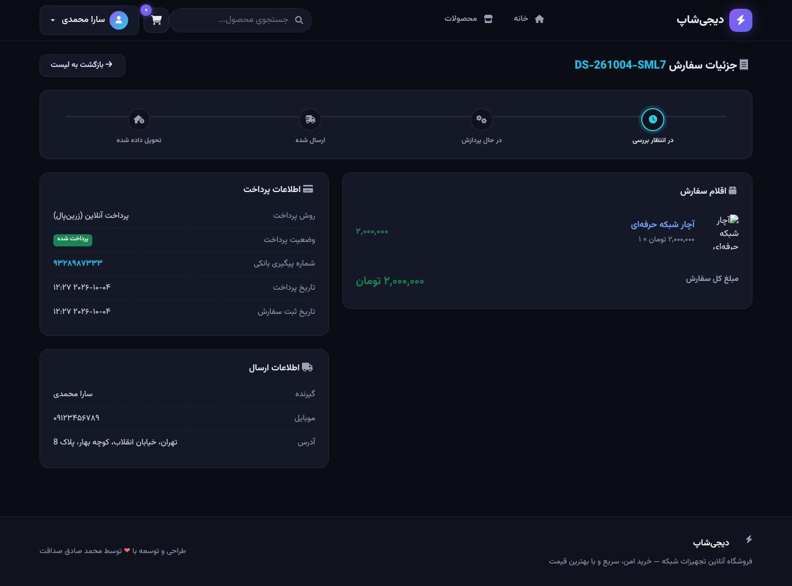 |

| Admin Dashboard | Admin Orders |
|:---:|:---:|
| 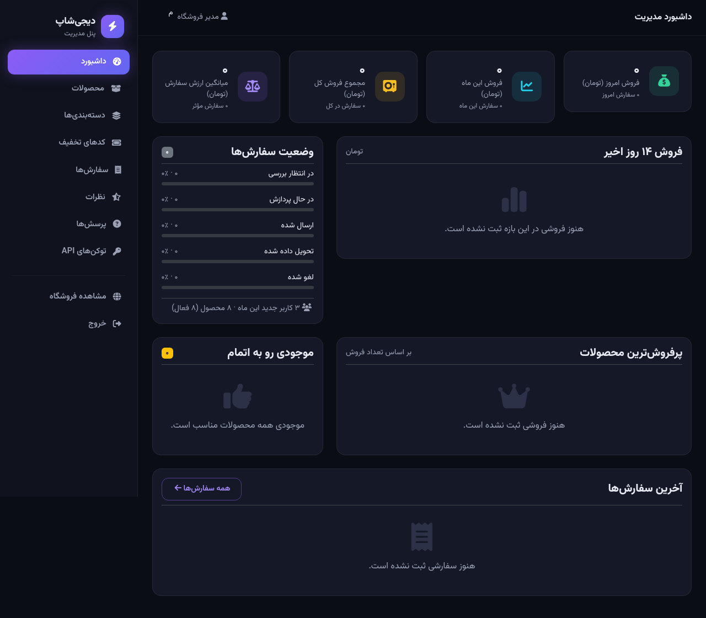 | 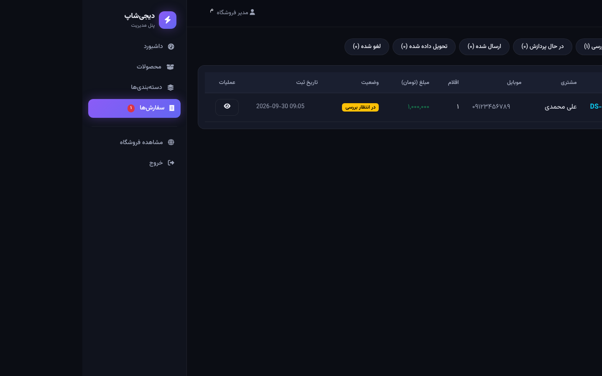 |

| Product Detail (gallery) | Admin Gallery Form |
|:---:|:---:|
| 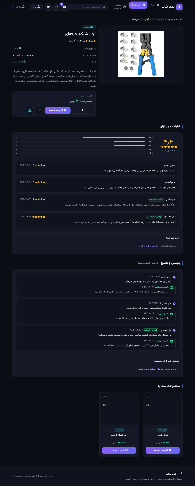 | 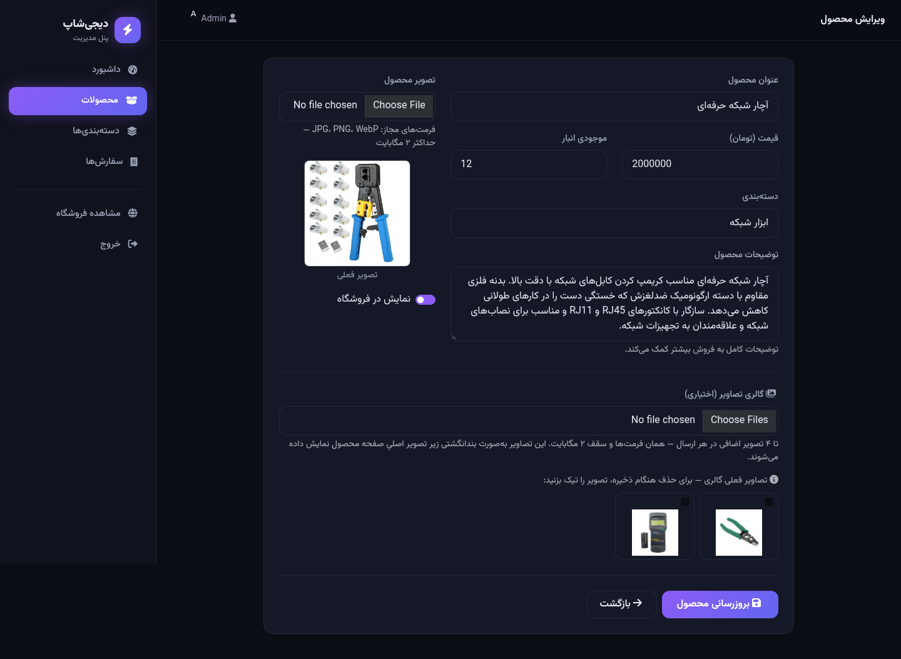 |

| Cart with Coupon | Admin Coupons |
|:---:|:---:|
| 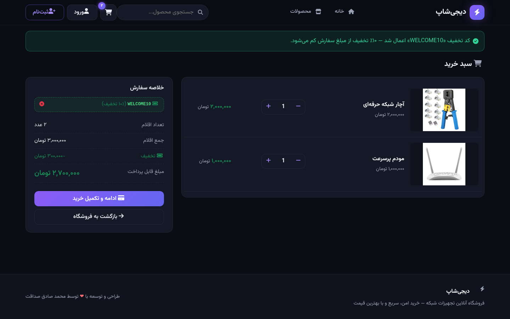 | 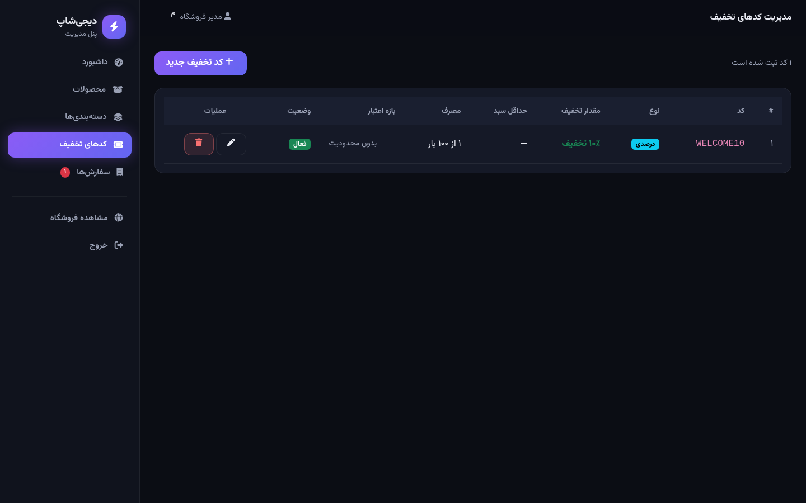 |

| Product Comparison | |
|:---:|:---:|
| 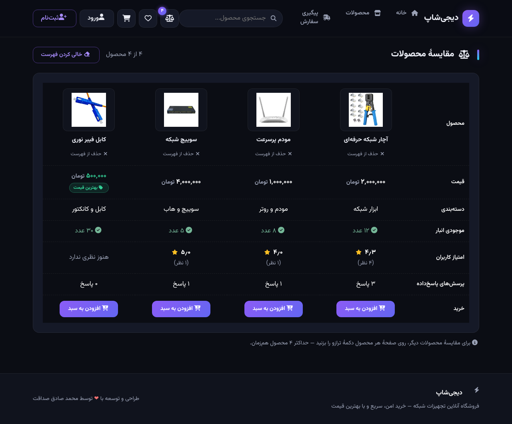 | |

| REST API (Sanctum) | Admin API Tokens |
|:---:|:---:|
| 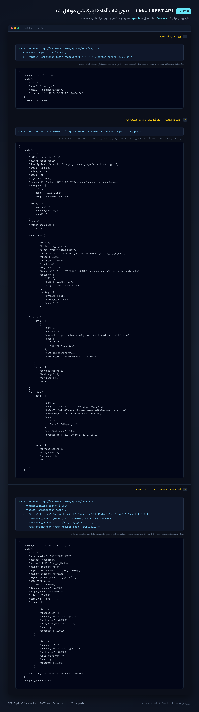 | 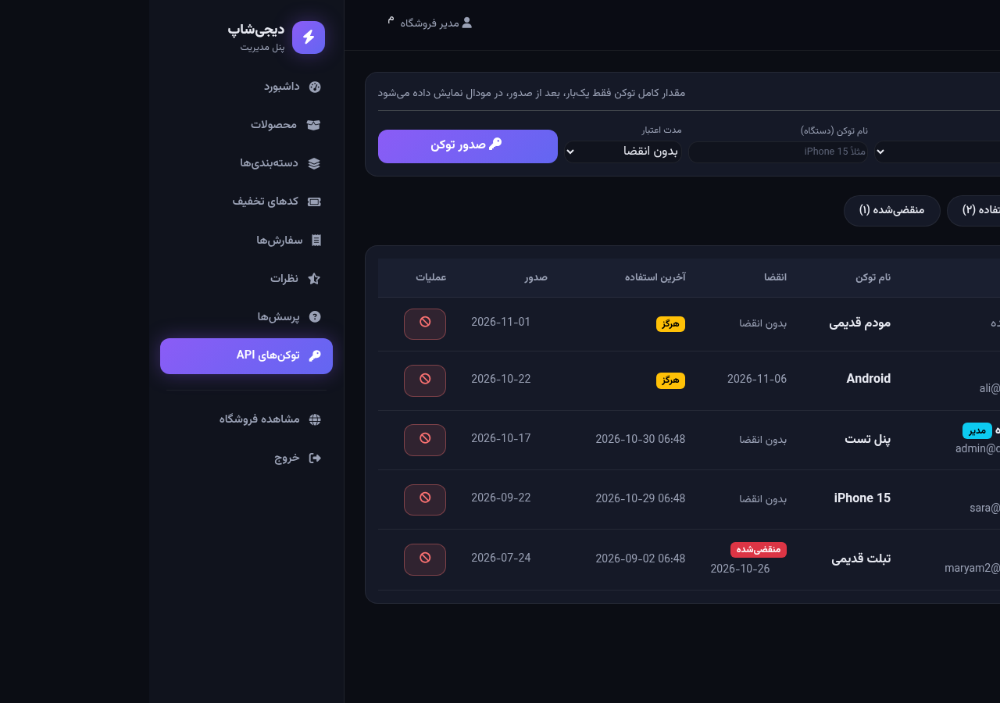 |

</div>

## 🌐 Live Preview (GitHub Pages)

A **static demo page** of the shop UI is hosted on GitHub Pages:

> **<https://mss1625.github.io/shop-php/>**

It replicates the home page (hero, categories, product cards) with the real sample products. Note that GitHub Pages only serves static files — the *full* application (cart, checkout, payment, admin panel) runs with PHP, via the 4-command quick start below. The preview link is also listed in the repo **About** sidebar, so it is visible right on the project page.

## ✨ Features

- 🐳 **Docker — one command, the whole shop** — `docker compose up -d --wait` boots PHP-FPM + nginx + MySQL 8.4 (three containers, one image) and serves on http://localhost:8080; the first boot waits for the database, runs the same idempotent `shop:install` (migrations + seeders) unattended, and `docker compose run --rm test` even runs the whole test suite inside a container — no PHP on the host needed
- 📡 **REST API v1 (Sanctum, mobile-ready)** — the whole store behind 18 token-authenticated endpoints under `/api/v1`: register/login/logout (per-device tokens), catalog with the same filters as the storefront (Persian-digit price ranges included), one-call product detail (gallery + rating breakdown + verified-badge reviews + answered questions + related), **direct order placement with coupons** through the same `PlaceOrder` service as the web checkout, order history/cancel, idempotent wishlist and review/question submission — 60 req/min rate limit, standard 422/401/409 responses
- 🔑 **Admin API Token Management** — every token in one table on `/admin/tokens`: owner (blue «مدیر» badge, «کاربر حذف‌شده» for orphans), device, issue date, last use («هرگز» badge) and expiry (red «منقضی‌شده»); **issue tokens from the panel** (user + device name + lifetime of no-expiry/7/30/90 days — Sanctum enforces the expiry at auth time), the plain token appears **exactly once** in a copyable modal and the DB keeps only the hash; **one-click revoke** with confirm dialog; tabs «همه / بدون استفاده / منقضی‌شده» point at the cleanup candidates
- 💳 **Online Payment (ZarinPal)** — full payment-gateway integration (ZarinPal v4 API) with server-side verification, retry-on-failure, plus Cash-on-Delivery option; ships with a local **mock gateway** so you can test the whole payment flow without a merchant account
- 👤 **Customer Accounts** — registration/login, personal dashboard with purchase stats, full order history and order tracking timeline; guests can still checkout
- 🚚 **Guest Order Tracking** — a public `/track` page where customers follow their order with just the order number + the mobile number used at checkout; same 4-step timeline, payment status and payment retry — rate-limited, uniform errors (anti-enumeration) and a minimum-data result page
- 🛒 **Full Shopping Cart** — session-based cart with AJAX add/update/remove
- ❤️ **Wishlist** — one click on the heart saves a product for later (card corner + product page); a second click removes it — Ajax flip with a live navbar counter, PRG fallback without JavaScript, a dedicated `/wishlist` page (newest first, 12 per page) and one row per user/product backed by a DB unique constraint
- ⚖️ **Product Comparison** — a session-based compare list capped at 4 products, so guests can compare without an account: one click on the scale (card corner, product page, or the navbar badge) and `/compare` lines them up side by side — price, category, stock, rating and answered questions in one table, with the cheapest column highlighted by a green **«بهترین قیمت»** badge; aggregates run in one query (no N+1), the table keeps insertion order, a deactivated product silently drops out and the session heals itself, and a 5th product is refused with a friendly cap warning
- ❓ **Product Q&A** — customers ask questions right on the product page; questions stay private until an admin answers them from the `/admin/questions` panel (answer box right inside the table row), then go public with «پاسخ دیجی‌شاپ» branding and the same verified-buyer badge as reviews — plus a «پاسخ پرسش شما» email to the asker, sent once (edits are silent) and never breaking on SMTP failure
- 📦 **Order Management** — checkout flow, order tracking, status workflow (pending → processing → shipped → delivered / cancelled), automatic stock adjustment, customer-initiated cancellation with stock restore
- 🔍 **Search, Filter & Sort** — live product search, category filters, **price-range and in-stock filters** (Persian-digit friendly, backwards ranges are silently swapped), **best-selling sort** (cancelled orders excluded), price sorting, pagination — and related products on the detail page always show in-stock items first
- ⭐ **Reviews & Ratings** — 1–5 star reviews on the product page with a big average, 5→1 breakdown chart and the **«خریدار تأییدشده» (verified buyer) badge** for authors who actually bought the product; every review waits for admin approval, cards show the rating everywhere, and one review per user per product is enforced
- 🗂 **Categories** — dynamic categories with icons and product counts
- 📊 **Admin Reports Dashboard** — revenue KPIs (today / this month / all-time / average order value), a 14-day sales chart fed by a single grouped query, best sellers ranked by units sold, order-status breakdown with progress bars, low-stock & out-of-stock alerts — all queries collected in one testable `DashboardStats` service
- 🖼 **Secure Image Upload** — validated images only (JPG/PNG/WebP, max 2MB), random filenames
- 🖼️ **Product Gallery** — multiple images per product; thumbnail strip on the detail page swaps the main view; IDOR-safe delete in admin
- 🎟 **Discount Coupon Codes** — percent/fixed codes with usage caps, minimum-cart, expiry window; race-safe redemption inside the order transaction and a full admin management page
- 📧 **Order Email Notifications** — order-placed, payment-confirmed and status-changed emails with RTL Persian templates; contract-based (`OrderNotifier`); failures are isolated — a broken SMTP never breaks checkout
- 📱 **SMS Notifications (Kavenegar)** — the same three order events as short Persian text messages; a second `SmsGateway` contract implementation (`KavenegarSmsGateway` for real delivery, `LogSmsGateway` for dev/tests) plus `CompositeNotifier` so email and SMS work side by side — plugged in through one binding, with zero controller changes
- 🌐 **Persian-first** — RTL layout, Vazirmatn font, Persian digits (۰۱۲۳۴۵۶۷۸۹), Toman currency
- 🌙 **Dark Modern UI** — neon violet theme built on Bootstrap 5 RTL
- 🔐 **Security Hardened** — CSRF protection, rate-limited login, XSS-safe templating, mass-assignment protection, security headers, atomic payments

## 📡 REST API v1 (Mobile-Ready)

All endpoints live under `/api/v1` and return JSON. Authenticate with a Sanctum token: send `Authorization: Bearer <token>` (get one from login/register). Rate limit: 60 req/min per token.

| Method | Endpoint | Auth | Description |
|---|---|---|---|
| POST | `/auth/register` | — | Create account + token (`device_name` optional) |
| POST | `/auth/login` | — | Issue token (generic error message, 10/min) |
| GET | `/auth/me` | ✅ | Current profile |
| POST | `/auth/logout` | ✅ | Revoke **current device's token only** |
| GET | `/categories` | — | Categories with active-product counts |
| GET | `/products` | — | Same filters as the shop: `q`, `category`, `min`, `max` (Persian digits OK), `in_stock`, `sort` (incl. `popular`) |
| GET | `/products/{slug}` | — | One-call product screen: gallery, rating summary + 5→1 breakdown, reviews + questions (first page, verified badges), 4 related |
| GET | `/products/{slug}/reviews` | — | Approved reviews, paginated (10/page) |
| POST | `/products/{slug}/reviews` | ✅ | Submit review (starts pending; one per user/product) |
| GET | `/products/{slug}/questions` | — | Answered questions, paginated (10/page) |
| POST | `/products/{slug}/questions` | ✅ | Ask a question (starts pending) |
| GET | `/wishlist` | ✅ | Saved products (active only, newest first, 12/page) |
| POST | `/wishlist/{slug}` | ✅ | Add (idempotent) |
| DELETE | `/wishlist/{slug}` | ✅ | Remove (idempotent) |
| GET | `/orders` | ✅ | My orders (10/page, newest first) |
| POST | `/orders` | ✅ | **Place an order directly** — `items[{slug,quantity}]`, customer fields, `payment_method`, `coupon_code`; ZarinPal orders return `payment_url` |
| GET | `/orders/{order_number}` | ✅ | Order details (own orders only → 404) |
| POST | `/orders/{order_number}/cancel` | ✅ | Cancel a pending unpaid order (atomic restock) |

```bash
# Login and grab a token
curl -s -X POST http://localhost:8000/api/v1/auth/login \
  -H "Accept: application/json" -H "Content-Type: application/json" \
  -d '{"email":"you@example.com","password":"secret","device_name":"Pixel 8"}'

# Place an order from the app, with a coupon
curl -s -X POST http://localhost:8000/api/v1/orders \
  -H "Authorization: Bearer $TOKEN" -H "Accept: application/json" \
  -H "Content-Type: application/json" \
  -d '{"items":[{"slug":"network-switch","quantity":1}],
       "customer_name":"سارا محمدی","customer_phone":"09123456789",
       "customer_address":"تهران، خیابان ولیعصر، پلاک ۱۲",
       "payment_method":"cod","coupon_code":"WELCOME10"}'
```

Order responses carry raw values for your app logic (`status`, `total`) **and** ready-made Persian labels for display (`status_label`, `total_fa`) — plus `payment_url` for online orders (open it in a WebView).

## 🚀 Quick Start (SQLite — zero config)

```bash
# 1) Clone and install
git clone https://github.com/MSS1625/shop-php.git
cd shop-php
composer install

# 2) One-command setup (env + key + migrate + seed + storage link)
php artisan shop:install

# 3) Create an admin user (interactive)
php artisan admin:create

# 4) Serve
php artisan serve
```

Open **http://localhost:8000** — the shop is ready with 8 sample products. 🎉

## 🐳 Run with Docker (one command)

The full store — PHP-FPM app, nginx web server and MySQL 8.4 database — boots with a single command. Nothing but Docker needs to be installed:

```bash
git clone https://github.com/MSS1625/shop-php.git
cd shop-php
docker compose up -d --wait
# → http://localhost:8080
```

**Three containers, one image:** `app` (php-fpm + the Laravel app, port 9000 inside the compose network), `web` (the *same image* in web role — nginx serves the static files of `public/` straight from the image and proxies PHP to `app:9000` by service name) and `db` (official `mysql:8.4` with a health-checked data volume).

What happens on the first boot:

- the entrypoint copies `.env.docker` → `.env`, waits for MySQL to be really ready (`depends_on` only guarantees order, not readiness — the compose healthchecks plus a small retry loop do the actual gating), then runs `php artisan shop:install`: migrations, idempotent seeders (8 sample products) and the storage link, all unattended
- admin login is `admin@digishop.local` — the random password is printed **once** in `docker compose logs app`; to set your own, put `ADMIN_PASSWORD=…` in `.env.docker` and boot with `docker compose up -d --build`
- uploaded product images (the `storage-data` volume) and the database (the `db-data` volume) survive restarts and rebuilds; only `docker compose down -v` wipes them

```bash
docker compose logs -f app        # Laravel logs on stderr (emails land here too)
docker compose run --rm test      # the whole 306-test suite, inside a container (SQLite in-memory)
docker compose down               # stop — data stays in the volumes
docker compose down -v            # stop and wipe the data
```

Change the host port with an `.env` file next to `docker-compose.yml`: `echo 'DIGISHOP_PORT=3000' > .env`.

## ☁️ Deploy to a Free VPS (production, HTTPS)

The production stack adds a fourth service — **Caddy** — as the only public entry point: it obtains the Let's Encrypt certificate for your domain automatically, renews it, redirects HTTP→HTTPS and proxies everything to the `web` service. Two commands on any Ubuntu server:

```bash
cp .env.production.example .env.production      # set your domain + strong DB passwords
docker compose --env-file .env.production -f docker-compose.prod.yml up -d --build --wait
```

The full step-by-step — an honest comparison of the 2026 free tiers (Oracle Always Free, GCP, Codespaces, Render), the Oracle Security List trap, DNS-first-then-deploy, backups and troubleshooting — lives in **[docs/DEPLOY.md](docs/DEPLOY.md)** (فارسی: [docs/DEPLOY.fa.md](docs/DEPLOY.fa.md)).

## 🛠 Setup with XAMPP / MySQL

1. Create an empty database named `shop_php` in phpMyAdmin
2. Edit `.env` — comment the SQLite line and uncomment the MySQL block:

```env
# DB_CONNECTION=sqlite
DB_CONNECTION=mysql
DB_HOST=127.0.0.1
DB_PORT=3306
DB_DATABASE=shop_php
DB_USERNAME=root
DB_PASSWORD=
```

3. Run the installer:

```bash
php artisan shop:install
php artisan admin:create
php artisan serve
```

> **Requirements:** PHP 8.2+ with `pdo_sqlite` (or `pdo_mysql`), `mbstring`, `gd`, `fileinfo` — all enabled by default in XAMPP.

## 💳 Payment Gateway (ZarinPal)

The payment layer is built on a clean `PaymentGateway` contract, so gateways are swappable. Three modes are supported via `.env`:

| Mode | `ZARINPAL_MODE` | Description |
|---|---|---|
| **Mock** (default) | `mock` | Local payment simulator — no internet or merchant account needed; perfect for development & demos |
| **Sandbox** | `sandbox` | ZarinPal sandbox environment (`sandbox.zarinpal.com`) for testing with the test merchant UUID |
| **Production** | `production` | Real payments (`payment.zarinpal.com`) |

To go live, get your **Merchant ID** (36-char UUID) from the [ZarinPal panel](https://zarinpal.com) and set:

```env
ZARINPAL_MERCHANT_ID=xxxxxxxx-xxxx-xxxx-xxxx-xxxxxxxxxxxx
ZARINPAL_MODE=production
# مبلغ سفارش‌ها «تومان» است و API زرین‌پال «ریال» می‌گیرد؛ ضریب پیش‌فرض ۱۰ است
ZARINPAL_AMOUNT_MULTIPLIER=10
```

**How the payment flow works:** checkout → order created (atomic, stock reserved) → redirect to gateway → server-side **verify** on callback (never trusting the query string) → order marked as `paid` with bank `ref_id`. Failed or cancelled payments can be retried by the customer. Cash on Delivery remains available as a second option.

## 🔐 Security Features

| Threat | Protection |
|---|---|
| SQL Injection | Eloquent ORM + prepared statements everywhere |
| XSS | Blade `{{ }}` auto-escaping — no raw output |
| CSRF | `@csrf` on all forms, `VerifyCsrfToken` middleware |
| Brute Force | 5 failed logins/minute per email+IP (throttle + RateLimiter) |
| Malicious Uploads | `image` validation + MIME whitelist + 2MB limit + random names |
| Session Fixation | Session ID regenerated on login |
| Mass Assignment | Explicit `$fillable` whitelists |
| Clickjacking | `X-Frame-Options: DENY` + security headers middleware |
| Payment Tampering | Gateway result is **verified server-to-server** (verify.json); query params are never trusted |
| IDOR on orders | Orders are visible only to their owner (or admin); payment pages are session-bound |
| Default Credentials | None — admin is created interactively via `admin:create` (or seeded with a strong random password) |

## 📁 Project Structure

```
app/
├── Console/Commands/      # shop:install و admin:create
├── Contracts/             # PaymentGateway (قرارداد درگاه پرداخت)
├── Exceptions/            # StockUnavailable, PaymentGateway, PaymentVerificationFailed
├── Http/
│   ├── Controllers/
│   │   ├── Admin/         # Dashboard, Product, Category, Order
│   │   ├── Auth/          # AdminLogin, Login, Register
│   │   └── Shop/          # Home, Product, Cart, Checkout, Payment, Account
│   ├── Middleware/        # EnsureUserIsAdmin, SecurityHeaders
│   └── Requests/          # Form Request validations
├── Models/                # Product, Category, Order, OrderItem, User
├── Services/
│   ├── Cart.php           # سرویس سبد خرید مبتنی بر سشن
│   ├── Compare.php        # سرویس مقایسهٔ محصولات (سشن، سقف ۴)
│   └── Payments/          # ZarinPalGateway, MockGateway
database/seeders/images/   # تصاویر نمونه محصولات
docs/                      # صفحه دموی ایستا برای GitHub Pages
public/assets/             # تم دارک + اسکریپت سبد خرید
resources/views/           # Blade templates (shop + admin + auth + account)
.github/workflows/ci.yml   # اجرای خودکار تست روی هر push
.github/workflows/release.yml # انتشار خودکار Release از روی تگ
Dockerfile                  # ایمیج چندمرحله‌ای (composer → php:8.3-fpm-alpine)
docker-compose.yml          # app + web + db — یک دستور: docker compose up -d --wait
docker-compose.prod.yml     # استک پروداکشن: app + web + db + caddy (HTTPS خودکار)
deploy/Caddyfile            # پروکسی معکوس: دامنه + گواهی Let's Encrypt خودکار
.env.production.example     # قالب تنظیمات پروداکشن (دامنه + رمزهای دیتابیس)
docker/                     # nginx.conf، entrypoint.sh، await-db.php
docs/DEPLOY.md / DEPLOY.fa.md  # راهنمای دیپلوی روی VPS (انگلیسی | فارسی)
README.md / README.fa.md   # English | فارسی
```

## 🧪 Tests & CI

```bash
php artisan test                  # 306 tests (1187 assertions)
vendor/bin/pint --test            # code style
vendor/bin/phpstan analyse        # Larastan level 5 (0 errors)
composer check                    # هر سه با هم — همان دروازهٔ CI
```

Every `push` and `pull request` runs five GitHub Actions jobs automatically: the test matrix (PHP 8.2 / 8.3 / 8.4), Pint, **Larastan level 5** static analysis, and a **Docker job** that builds the production image, boots the whole compose stack (healthcheck-gated: MySQL up, fpm running, storefront answering), smoke-tests the rendered homepage and validates the production compose file — see the badges at the top. On every push to `main`, a coverage job runs the suite with pcov and publishes the live **Coverage** badge (from the `coverage-badge` branch — it appears after the first run on `main`). Push a tag `v*` and the `release` workflow runs the tests, then creates the GitHub Release with the bilingual notes extracted from `CHANGELOG.md`.

Inside a container (no PHP on the host needed): `docker compose run --rm test`.

## 🗺 Roadmap

- [x] Online payment gateway (ZarinPal)
- [x] Customer accounts & order history
- [x] GitHub Actions CI
- [x] CI automation upgrade (Larastan level 5 + coverage badge + auto-release)
- [x] Project website (GitHub Pages demo)
- [x] Product gallery (multiple images)
- [x] Discount codes
- [x] Email notifications
- [x] SMS notifications
- [x] Admin reports dashboard (KPIs, best sellers, 14-day chart)
- [x] Guest order tracking (public /track page)
- [x] Smart product discovery (price range, in-stock filter, best-selling sort, related-products upgrade)
- [x] Product reviews & ratings (verified-buyer badge, moderation workflow, rating summary + breakdown)
- [x] Customer wishlist (heart toggle, /wishlist page, live navbar badge)
- [x] Product comparison (session list up to 4, /compare table with best-price badge, guest-friendly)
- [x] Product Q&A (ask on the product page, admin answer workflow, answer email)
- [x] REST API v1 with Sanctum (mobile-ready: token auth, catalog, direct orders, wishlist, reviews, questions)
- [x] Admin API token management (issue from the panel with one-time display, audit table, one-click revoke)
- [x] Docker deployment (one-command compose stack: app + web + db, CI-tested)
- [x] Production deployment on a free VPS (Caddy edge, automatic HTTPS, bilingual deploy guide)

## 🤝 Contributing

PRs are welcome! Run `composer test` and `vendor/bin/pint` before submitting. See [CONTRIBUTING.md](CONTRIBUTING.md).

## 👤 Author

**Mohammad Sadegh Sedaghat** — with ❤️

## 📄 License

[MIT](LICENSE)
